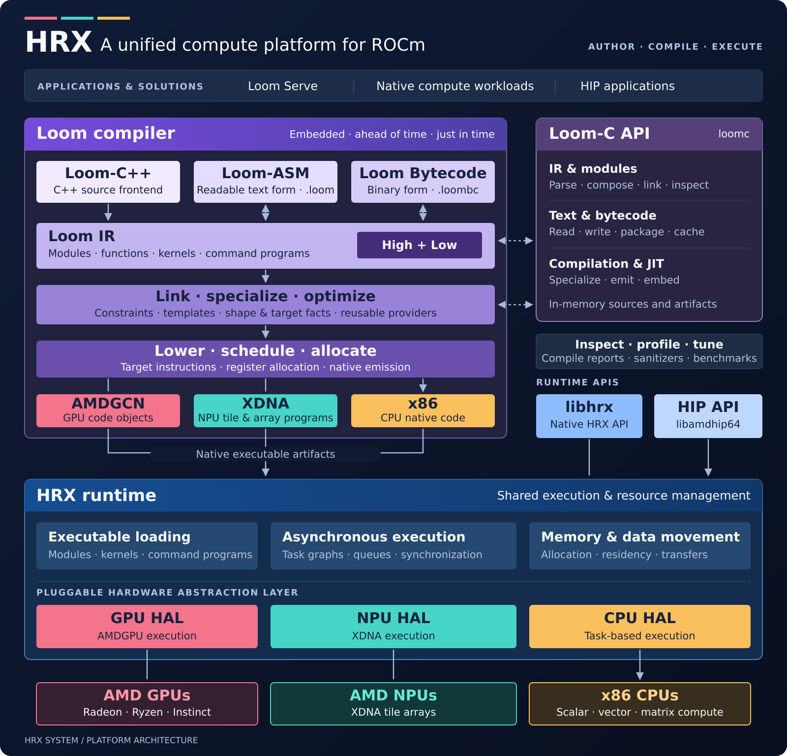

# HRX Solutions

HRX Solutions is executable documentation for building accelerated applications
on [HRX (HIP Runtime eXtended)](https://github.com/ROCm/hrx-system), a unified
compute platform for ROCm. Its worked solutions define application structure
and model policy in Loom source, backed by reusable compiler, execution, and
memory services. They provide runnable applications, implementation patterns,
and components that developers and agents can adapt to their own workloads.

Start with [LLM serving](docs/solutions/llm-serving.md) to run a local model
and connect an agent. HRX is a new subsystem being evaluated for inclusion in
ROCm, providing an alternative implementation of the runtime, compiler, and
library stack.

## How the pieces fit



*HRX platform architecture. The [tested serving profile](docs/serving/profiles.md)
documents the hardware, model, and interface coverage of this solution.*

## What the serving solution demonstrates

The LLM solution brings model computation, retained request state, speculative
decoding, and streaming chat together through explicit ownership boundaries:

* **Source-defined policy.** Loom sources own model geometry, weight
  preparation, execution programs, state layouts, and chat/tool conventions.
  Those choices can be inspected and changed alongside the model.
* **Shared execution infrastructure.** Native HRX owns admission, scheduling,
  transport, physical storage, and execution services. Requests share weights,
  compiled commands, and execution infrastructure while retaining independent
  state.
* **Deployment specialization.** The server loads the packaged bytecode catalog and
  compiles for the device and configured capacities. Model-policy changes within the
  existing execution contract can reuse the native server executable.

The [pipeline guidebook](loom-pipeline/llm/README.md) follows these boundaries
from import to generated tokens and shows where to make and check a change.

Existing projects can adopt HRX components, specialized stacks can build on
the substrate, and these reference solutions explore what becomes possible
when application and substrate are developed together. The
[proposed llama.cpp integration](https://github.com/ggml-org/llama.cpp/discussions/27219)
is one example of adopting the technology within an established project.

We use these solutions ourselves and maintain a selective catalog to make
useful platform capabilities accessible. New examples should demonstrate
something worth building on. Some may eventually become products; direct use
and adaptation are encouraged.

## Solution Catalog

| Solution | What you can do |
| --- | --- |
| [LLM serving](docs/solutions/llm-serving.md) | Acquire model assets, operate Loom Serve directly, and configure Pi. |

Image serving, audio, NPU workloads, and interactive applications such as [Doom](https://gist.github.com/benvanik/20fbfd298ab1d53588ad12aedade6457)
are candidates for future worked solutions.

## Install from PyPI

PyPI publishing is pending. Once available, install in a Python 3.9 or newer
virtual environment:

```bash
# Installing in a venv is recommended.
python -m pip install hrx-solutions

# Inspect the direct native launcher.
loom-serve --help
```

Continue with the [LLM serving walkthrough](docs/solutions/llm-serving.md)
to acquire the pinned assets, author deployment JSON, start the server, and
configure Pi. For a wheel obtained before PyPI publication, begin with the
[installation instructions](docs/solutions/llm-serving.md#install-and-choose-your-files).

To manage model assets and server lifecycles with `loom-control`, use the
[Loom Control companion guide](docs/solutions/loom-control.md). Loom Control
prints readable results by default; scripts that previously parsed default JSON should add `--json`.
Native/HF/curl equivalents remain visible on stderr. Run `loom-control` or a bare
resource such as `loom-control instance` for guidance and configuration help.

## Agent Guidebooks

Guidebooks trace execution through the source and explain the design choices
behind each solution. Start here when modifying an implementation:

* [LLM pipelines](loom-pipeline/llm/README.md): model import and validation,
  source JIT, request flow, state ownership, kernels, and extension points.

## HRX design principles

* **Compact and embeddable.** The native stack supports static linking and
  redistribution. The serving wheel bundles its user-space ROCm runtime
  libraries; deployment needs a compatible driver, while building the wheel
  requires the SDK described below.
* **Targets AMD compute hardware.** The platform targets Radeon, Ryzen, and
  Instinct GPUs, XDNA NPUs, and x86 CPUs, including matrix acceleration.
* **Designed for agent authorship.** The [Loom compiler](https://rocm.github.io/hrx-system/loom/)
  accepts [Loom ASM](https://rocm.github.io/hrx-system/loom/reference/) and a
  customized C++ dialect. Explicit state and ownership, inspectable generated
  code, and localized policy changes let agents trace an edit through to its
  behavior and validation.
* **Heterogeneous execution.** The programming model supports pipelined and
  resident co-execution across CPU, GPU, and NPU, including local and remote
  compute units.
* **AI components in one place.** Tokenization, serving JIT, KV-cache management,
  weight preparation and streaming, and virtual memory management share one
  native codebase.
* **Integrated optimization tools.** Compilation reports, profiling,
  sanitizers, tests, and benchmarks connect source choices to generated code
  and observed execution.
* **HIP compatibility.** The HIP implementation enables incremental adoption
  by existing HIP applications.
* **Evolution through use.** We develop and refine the platform with agents
  on real workloads. As approaches mature, we document them and publish
  corresponding solutions.

## Build and Install Locally

### Native Bazel build

This repository is the Bazel root. `@hrx_system` supplies HRX's compiler,
runtime, and the current Loom Serve executable. `MODULE.bazel` records the
source revision and is the source pin for both native and wheel builds.

Put the following in the ignored `.bazelrc.local`, adjusting the SDK and
compiler paths:

```text
common --repo_env=IREE_ROCM_PATH=/path/to/rocm
common --repo_env=CC=/path/to/rocm/lib/llvm/bin/clang
common --repo_env=CXX=/path/to/rocm/lib/llvm/bin/clang++
```

For development against a sibling `hrx-system` checkout, build from this
repository with an explicit absolute override:

```bash
bazel build --config=opt --override_module="hrx=$PWD/../hrx-system" //...
bazel run --config=opt --override_module="hrx=$PWD/../hrx-system" //:loom-serve -- --help
```

`//:native` groups the native deliverables; `//:loom-serve` aliases the public
HRX executable. Bazel manages dependencies directly, without `.deps/hrx`.
The pinned module applies a narrow checked-in patch to HRX's generated-file
rule so it matches external-repository output names. The patch leaves the
pinned revision unchanged and allows builds without a sibling override.

### Python wheel build

CI runs Python checks, the manylinux build, and the wheel installation check on
one GitHub-hosted Ubuntu runner. Only the model lifecycle/query test uses a GPU runner.
The same build and installation checks can run locally from a clean checkout:

```bash
bash build_tools/build-wheel.sh
bash build_tools/check-wheel.sh build/wheel/wheelhouse/*.whl /path/to/new-check-venv
```

The build requires Docker and writes to `build/wheel/`. It runs as your user in
the pinned manylinux image. The installation check runs on the host in a new
venv, without the build container's toolchain or environment. The build checkout
must have no conflicting local Bazel configuration; for a host-native build,
use the setup below.

To reuse native compilation between local container builds, select a dedicated
absolute directory outside this checkout:

```bash
HRX_BAZEL_CACHE_DIR=/path/to/wheel-cache bash build_tools/build-wheel.sh
```

The first run creates an empty cache. Later builds reuse matching Bazel actions,
including snapshots from older source revisions, while still building and
validating the current wheel. Unusable cache storage or unsupported snapshot
metadata disables caching for that invocation. Omit the variable, or set
`HRX_BAZEL_CACHE_ENABLED=0`, to bypass caching. The snapshot contains only
`bazel-actions/` and provenance in `manifest.json`; it does not contain the SDK,
wheel, or Bazel server state. Publication admission requires a completed build,
stable contents, and apparent and allocated sizes of at most 3 GiB. An oversized
snapshot is not uploaded; local compilation can continue using it.

From a checkout, with a Python virtual environment activated, install
Bazelisk 1.29.0 on `PATH` and select a ROCm SDK containing the compiler, headers,
and runtime libraries:

```bash
python -m pip install build 'setuptools>=77' 'wheel>=0.45'
python build_tools/setup_python.py --rocm=/path/to/rocm
python -m build --wheel
python -m pip install --force-reinstall dist/hrx_solutions-*.whl
```

Use a `dist/` directory containing just the wheel you want to install, or pass
its exact filename. The setup command checks the Bazel version from
[.bazelversion](.bazelversion) and writes the local SDK selection to the ignored
`.bazelrc.configured`. Handwritten `.bazelrc.local` settings are loaded last.
Its `--help` includes commands to install the pinned Bazelisk.

The wheel build invokes Bazel for `//:loom-serve` and the Qwen bytecode catalog
from this root. It stages the executable, HRX license, redistributable ROCm libraries,
solution helpers, and exactly two complete `pipeline.loombc` modules, one per supported model specification. Authored `.loom` files remain
in the repository; the wheel ships bytecode instead. To use a sibling
checkout for wheel builds, add an absolute override to `.bazelrc.local`:

```bash
printf 'common --override_module=hrx=%s/../hrx-system\n' "$PWD" >> .bazelrc.local
```

Bazel's [MODULE.bazel](MODULE.bazel) pin is used when no override is present.
The package version comes from
[version.json](version.json) for both local builds and CI. See
[RELEASING.md](RELEASING.md) for release preparation, tags, GitHub assets, and
PyPI trusted publishing.

## License

The Python launcher and packaging code are MIT licensed; see [LICENSE](LICENSE).
Native code, checked-in pipeline sources, and bundled ROCm libraries retain
their upstream licenses and notices. Model weights are not redistributed.

Many HRX components were originally derived from [IREE](https://github.com/iree-org/iree)
and use the Apache license with LLVM exception. HRX also borrows or adapts
concepts from MLIR, without using MLIR code. Licenses in individual source
files are authoritative; see the [pipeline notices](loom-pipeline/llm/README.md#license-notices).
