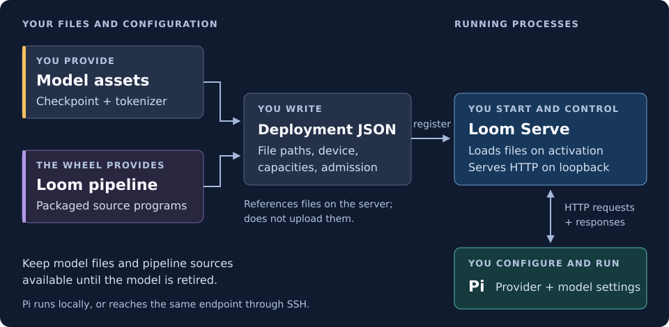

# Run Loom Serve with Pi

Run a model with `loom-serve`, control it through HTTP, and configure Pi to use
its endpoint. You supply the checkpoint and tokenizer, then copy and edit a
deployment example; the `hrx-solutions` wheel supplies the server and model pipeline.



The deployment connects files to a running process. Model paths belong to the
inference host: sending JSON to the server does not transfer those files.
A listening server can have no models loaded, and an accepted model registration
can still be preparing. We will check each transition before sending requests.

## Before you start

Use Linux x86-64 with a supported AMD GPU, a compatible driver and access to
`/dev/kfd` and the GPU's `/dev/dri/renderD*` node. Have Python 3.9+ with `venv`,
`curl` with `--fail-with-body`, and `jq`. Downloads below use the external `hf`
CLI and your normal Hugging Face login/cache. The wheel bundles user-space ROCm
libraries; a separate ROCm SDK is needed to build it, not to follow this guide.

The example uses **Qwen3.5 0.8B UD-Q5_K_XL**. It establishes serving and Pi
connectivity. This small model has **not qualified for ordinary Pi coding-agent
work**; correct client configuration does not establish model capability.
[Profiles and qualification](../serving/profiles.md) records the supported scope.

## Install and choose your files

On the inference host, create a working directory and activate a venv:

```bash
mkdir -p ~/loom-example/models
cd ~/loom-example
python3 -m venv .venv
source .venv/bin/activate
python -m pip install /absolute/path/to/hrx_solutions.whl
loom-serve --help
```

Replace the wheel path with your actual [release or build wheel](../../RELEASING.md).
PyPI publication is pending. Keep this as **terminal A**; its foreground server
will stay visible here.

Your files will look like this:

```text
~/loom-example/
├── .venv/                  # installed server and packaged Loom sources
├── models/
│   ├── Qwen3.5-0.8B-UD-Q5_K_XL.gguf
│   └── tokenizer.json
└── qwen08.json             # your deployment configuration
```

## Get the model

In terminal A, before starting the server, download the exact checkpoint and
matching tokenizer. Their repositories and revisions differ:

```bash
hf download unsloth/Qwen3.5-0.8B-GGUF Qwen3.5-0.8B-UD-Q5_K_XL.gguf \
  --revision b97f009053190ee1de01f886721d5e17d2bf4622 --local-dir models
hf download Qwen/Qwen3.5-0.8B tokenizer.json \
  --revision 2fc06364715b967f1860aea9cf38778875588b17 --local-dir models
```

Alternatively, copy your existing compatible files into `models/`, or retain
stable files elsewhere and use their absolute paths below. Similar filenames
or quantization labels do not establish compatibility. These coordinates match
the packaged `qwen-08b` contract; see [asset details](../serving/deployment.md#assets).

Locate the known pipeline once and print the three paths you will put in JSON:

```bash
PIPELINE_DIR=$(python -c 'from pathlib import Path; import hrx_solutions; print(Path(hrx_solutions.__file__).resolve().parent / "loom-pipeline/llm/qwen/qwen_08b")')
printf '%s\n' "$PIPELINE_DIR"
realpath models/Qwen3.5-0.8B-UD-Q5_K_XL.gguf models/tokenizer.json
```

Keep the model files and installed bytecode tree available until model retirement.
Do not edit the installed modules or replace the wheel while its model is loaded.

## Write the deployment

Save the complete [qwen08.json example](../serving/examples/qwen08.json) as
`~/loom-example/qwen08.json`. Edit its three `ABSOLUTE_...` strings using the
paths just printed. JSON does not expand `$HOME` or shell variables.

This is an **excerpt showing editable fields**, not a runnable document; the
complete example also contains the required source-provider list:

```json
{
  "name": "qwen3.8-27b",
  "device": 0,
  "admission": "drained",
  "base_directory": "ABSOLUTE_PIPELINE_DIR",
  "definition": {
    "weights": "ABSOLUTE_WEIGHTS_PATH",
    "tokenizer": "ABSOLUTE_TOKENIZER_PATH",
    "rows": 1,
    "context_capacity": 8192,
    "pool_capacity": 8192,
    "prefill_capacity": 128,
    "max_tokens": 512,
    "draft_depth": 0
  }
}
```

The deployment’s `name` determines HTTP routing and response model identity.
This walkthrough uses **`qwen3.8-27b`** as an example name, even for 0.8B weights.
You can choose another name; update the deployment, HTTP requests and Pi
configuration consistently. The control module’s internal policy name does not
restrict this choice.

`device: 0` selects the first member of the server's device group. One execution
row has an 8192-token context and shares an 8192-position retained-state pool;
prefill runs in packed shapes up to 128 tokens. Requests default to at most 512
output tokens. Input plus requested completion must fit the context. These are
logical limits, not a memory-fit promise. `draft_depth: 0` disables MTP, which
this small pipeline does not support. The [deployment reference](../serving/deployment.md)
explains bytecode paths and every editable field.

```bash
jq . qwen08.json
```

Inspect the paths and keep `admission` set to `drained`: registration should
start closed to requests while you prepare the model.

## Start the server

In **terminal A**, start an empty foreground process on loopback:

```bash
loom-serve --device=amdgpu --listen=127.0.0.1:8080
```

Leave it running. Its `ready` log record means the listener is accepting
connections, not that a model is loaded. If the port is occupied, choose another
unused port and use it consistently below.

Open **terminal B on the same host**:

```bash
cd ~/loom-example
source .venv/bin/activate
curl --fail-with-body -sS --max-time 10 http://127.0.0.1:8080/readyz
curl --fail-with-body -sS --max-time 10 http://127.0.0.1:8080/v1/status | jq '{server, data}'
```

Expect `{"status":"ready"}` and an empty `data` array. The status response also
identifies the selected GPU under `server.resources.devices`. Startup failures
appear in terminal A; correct device access or listener errors before continuing.

## Load the model

The lifecycle keeps preparation separate from admission:

```text
empty server → registered / drained → activated / ready → admission open
```

In **terminal B**, register your document:

```bash
curl --fail-with-body -sS --max-time 10 http://127.0.0.1:8080/v1/models/register \
  -H 'Content-Type: application/json' --data-binary @qwen08.json
curl --fail-with-body -sS --max-time 10 http://127.0.0.1:8080/v1/status | \
  jq '.data[] | select(.id == "qwen3.8-27b")'
```

HTTP 202 acknowledges registration. Confirm one matching entry with
`loom.status.admission: "drained"` and no `loom.error`. Note its positive
`loom.incarnation` number; subsequent observations must refer to that same
registration. At this point registration is metadata only; activation loads
sources, prepares weights and compiles for the device:

```bash
curl --fail-with-body -sS --max-time 10 http://127.0.0.1:8080/v1/models/activate \
  -H 'Content-Type: application/json' -d '{"model":"qwen3.8-27b"}'
curl --fail-with-body -sS --max-time 10 http://127.0.0.1:8080/v1/status | \
  jq '.data[] | select(.id == "qwen3.8-27b") | .loom | {incarnation, registration, parameter_operation, parameters, status, error}'
```

Repeat the status command for **up to 120 seconds**. Proceed only when the same
incarnation has all of these values:

| Field within `loom` | Required observation |
| --- | --- |
| `registration` | `"ready"` |
| `parameter_operation` | `"idle"` |
| `parameters.active` | `true` |
| `status.admission` | `"drained"` |
| `error` | Absent or `null` |

While preparation is running, keep waiting within that budget. On an error,
missing/replaced registration or timeout, stop here and inspect terminal A;
do not open admission. A timeout does not roll back accepted work. If a POST
response is lost, inspect status before retrying, especially registration.
[Lifecycle details](../serving/lifecycle.md) provides bounded automation.

Once ready, open admission and repeat the status observation:

```bash
curl --fail-with-body -sS --max-time 10 http://127.0.0.1:8080/v1/models/undrain \
  -H 'Content-Type: application/json' -d '{"model":"qwen3.8-27b"}'
curl --fail-with-body -sS --max-time 10 http://127.0.0.1:8080/v1/status | \
  jq '.data[] | select(.id == "qwen3.8-27b") | .loom | {incarnation, registration, parameter_operation, parameters, status, error}'
```

Confirm the same ready, active, error-free registration now has admission
`"open"` before sending a request.

## Send a first request

```bash
curl --fail-with-body -sS --no-buffer --max-time 30 \
  http://127.0.0.1:8080/v1/chat/completions \
  -H 'Content-Type: application/json' \
  -d '{"model":"qwen3.8-27b","messages":[{"role":"user","content":"Say Hello!"}],"stream":true,"temperature":0,"max_tokens":32}'
```

The stream should contain a short greeting in `choices[].delta.content`, a
terminal choice with non-null `finish_reason`, and `data: [DONE]`; curl must
exit successfully. Role-only events or an HTTP connection alone do not pass.
Temperature zero selects greedy generation. This model policy requires streaming
and rejects thinking mode; it does not implement every OpenAI API feature.
[Stream checks and recovery](../serving/troubleshooting.md) covers failures.

## Connect Pi

For automatically maintained configuration against local managed servers, use
[Loom Control’s Pi integration](loom-control.md#connect-pi-once). The steps below
configure a direct native endpoint manually.

Pi uses `~/.pi/agent/models.json` for static provider/model entries. This example
targets `@earendil-works/pi-coding-agent` **1.3.0**, requiring Node **22.19.0+**.
If Pi is not installed, install that version using your normal npm setup:

```bash
npm install -g @earendil-works/pi-coding-agent@1.3.0
pi --version
```

Create the configuration directory if needed:

```bash
mkdir -p ~/.pi/agent
```

Back up existing files before editing. **Merge** the following provider into
`models.json`'s `providers` object, preserving other providers, models and
credentials; use the complete object below only for a new file:

```json
{
  "providers": {
    "loom-local": {
      "baseUrl": "http://127.0.0.1:8080/v1",
      "api": "openai-completions",
      "apiKey": "local-unused",
      "compat": {
        "supportsStore": false,
        "supportsDeveloperRole": false,
        "supportsReasoningEffort": false,
        "supportsUsageInStreaming": true,
        "supportsStrictMode": false,
        "maxTokensField": "max_tokens"
      },
      "models": [{
        "id": "qwen3.8-27b",
        "name": "Loom Qwen 0.8B connection fixture",
        "contextWindow": 8192,
        "maxTokens": 512,
        "reasoning": false,
        "input": ["text"],
        "cost": {"input": 0, "output": 0, "cacheRead": 0, "cacheWrite": 0},
        "samplingParams": {"temperature": 0, "enable_thinking": false}
      }]
    }
  }
}
```

`baseUrl` includes `/v1`; Pi's `openai-completions` adapter appends
`/chat/completions`. The model ID and capacities match our deployment. The API
key is a non-secret Pi placeholder: this loopback server does not authenticate
requests, and this field does not add authentication. A dedicated provider name
avoids collisions with stored credentials. Compatibility settings omit storage,
developer-role, reasoning-effort and strict-mode assumptions, select `max_tokens`,
and request streaming usage. The sampling settings select greedy non-thinking
text output; zero costs are accounting metadata.

Pi's default history budgets exceed this 8K fixture. Merge these values into
`~/.pi/agent/settings.json`, preserving unrelated settings:

```json
{
  "compaction": {
    "modelOverrides": {
      "loom-local/qwen3.8-27b": {"reserveTokens": 1024, "keepRecentTokens": 2048}
    }
  },
  "branchSummary": {"reserveTokens": 1024}
}
```

The compaction override affects this model only; branch-summary reserve is
agent-wide, so review its effect on other models before changing it. Project
`.pi/settings.json` can override these settings. Start a new session after budget
changes. These limits fit the deployment; useful compaction and summaries remain
unqualified for this small model.

```bash
pi --list-models loom-local
```

Expect `loom-local`, model `qwen3.8-27b`, context about `8.2K` and output `512`.
To inspect the configured selection, start `pi` or use an existing interactive
session, then enter `/model` and choose that provider/model. Opening `/model`
reloads `models.json`. A resumed session may restore its previous model.
Listing and selection verify configuration, not inference. The
[optional restricted connection diagnostic](../serving/troubleshooting.md#check-pi-connectivity)
verifies a short request with a minimal prompt and tools disabled. **Ordinary
Pi prompts and tools remain unqualified for this 0.8B fixture.** For normal
coding-agent work, select and qualify a capable model with matching capacities.

For Pi on another machine, use the [SSH forwarding reference](../serving/remote-clients.md).

## Stop and restart

End Pi requests first. In **terminal B**, gracefully remove the model:

```bash
curl --fail-with-body -sS --max-time 10 http://127.0.0.1:8080/v1/models/unregister \
  -H 'Content-Type: application/json' -d '{"model":"qwen3.8-27b","mode":"drain"}'
curl --fail-with-body -sS --max-time 10 http://127.0.0.1:8080/v1/status | jq '.data'
```

HTTP 202 acknowledges removal intent. Repeat status observation for up to
120 seconds until the original incarnation disappears from `/v1/status`.
Graceful unregister finishes admitted work before releasing resources. On timeout,
keep the server and referenced files available and inspect progress; see
[retirement and cancellation](../serving/lifecycle.md#retirement).

After retirement, press **Ctrl-C in terminal A** and wait for the process to
return to the shell. Model files remain on disk. Ending Pi, retiring a model,
stopping this server and ending an SSH tunnel are separate actions.

Restarting the empty-server command loads no models. Repeat registration,
activation, readiness checks and undrain to load one again. For different
capacities, retire first, edit `qwen08.json`, then register again. Stop the
server before upgrading its wheel so loaded sources are not replaced underneath it.
