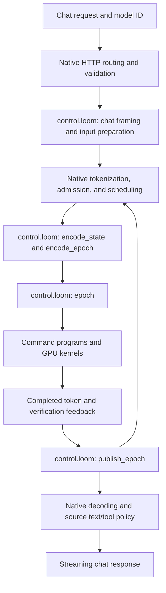

# LLM pipelines: an implementation guidebook

> **Upstream migration in progress:** The Python solution helpers and Qwen
> catalog are retained. This guide describes their earlier native serving
> contract; validation and startup adapters still need migration to the
> current server. See the [serving walkthrough](../../docs/solutions/llm-serving.md)
> for the current limitations.

This guide traces the LLM serving solution from model import through generated
tokens. Use the [serving walkthrough](../../docs/solutions/llm-serving.md) to
run it first, then return here to change model policy, kernels, or integration.

The default pipeline ID `qwen` selects `qwen/qwen_27b` for Qwen3.8-27B
UD-Q5_K_XL. Explicit `qwen-08b` selects `qwen/qwen_08b` for Qwen3.5-0.8B
UD-Q5_K_XL, including its exact per-layer Q4_K/Q5_K/Q6_K mix and tied Q6 output.
Dimensions, tensor names, quantization layouts, layer order,
and chat conventions are explicit in the source. Adapting it to another model
requires reviewing those choices, even when the checkpoint has a similar name.

## Ownership and reading order

Three layers cooperate:

| Layer | Owns | Start reading |
| --- | --- | --- |
| Python tools in this repository | Model inventory, validation dispatch, launch options, managed processes, client configuration | [`setup_cli.py`](../../binding/python/setup_cli.py), [`model_store.py`](../../binding/python/model_store.py), [`pipeline_validation.py`](../../binding/python/pipeline_validation.py) |
| Loom sources in this directory | Model geometry, tensor bindings, preparation policy, chat framing, command composition, device state layouts, numerical kernels | [`sources.txt`](qwen/qwen_27b/sources.txt), [`prepare.loom`](qwen/qwen_27b/prepare.loom), [`control.loom`](qwen/control.loom) |
| Native code in pinned HRX | HTTP transport, tokenization capabilities, admission, scheduling, physical storage, source JIT, command materialization, queue execution | Upstream [`serve/`](https://github.com/ROCm/hrx-system/tree/28d44d696030c65fc2ec91dd5a00e3d84166d5ca/loom/src/loom/serve) |

The native text server is model independent. It loads a source catalog at
startup and compiles for the actual device. Model policy can therefore change
within the existing execution contract without rebuilding that executable.
A wheel still needs to be rebuilt and reinstalled to distribute changed
sources to its users.

Read this guide in execution order, then follow the
[change map](#where-to-make-a-change) to the relevant files. For a concrete
editing task, see [changing chat framing](#example-changing-chat-framing).
The [evidence roadmap](#evidence-roadmap) describes measurements to collect
after establishing correctness. Native paths below are relative to
`experimental/loom_serve/` in the earlier HRX revision documented under
[Provenance](#provenance).
Current native builds use the dependency in [`MODULE.bazel`](../../MODULE.bazel).

## Why these boundaries matter

The ownership split gives an engineer or agent a way to locate a change,
identify the state it can affect, and choose a check for that behavior:

* **Chat policy stays with the model.** Prompt fragments and tool conventions
  are defined in `control.loom`. A framing change can use the existing native
  protocol and rendering hooks; a new request field may also require a change
  to native request validation. Both sides of that boundary are explicit.
* **Weight preparation stays with its consumers.** `weights.loom` selects
  preparation programs, and layer programs bind the resulting layouts. A
  kernel-specific layout can be implemented alongside the model while the
  generic loader continues to manage weight storage and execution lifetimes.
* **Requests share execution while retaining their own state.** The scheduler
  packs ready work over shared weights and commands. Source-defined origin
  records let stateful kernels locate each request's attention and recurrent
  state independently of its position in a packed token matrix.

These boundaries make changes traceable through source, compiled commands,
and runtime behavior. The checks later in this guide exercise different parts
of that path. Adapting a model still requires reviewing its dimensions,
layouts, semantics, and fit with the native execution contract.

## 1. Import, validate, and select a pipeline

[`model_store.py`](../../binding/python/model_store.py) obtains local files or
runs `hf download`, checks GGUF magic and tokenizer JSON, and hashes the assets.
It stages a directory and publishes it with a rename so partial imports do
not appear as installed models. An import has this layout:

```text
~/.loom/models/<model-id>/
  model.gguf
  tokenizer.json
  manifest.json
```

Files are copied by default or symlinked with `--alias`. Paths passed to native
code must be absolute while preserving their visible filenames. Extensions
matter for weight files, and the symlinks must preserve them.

[`pipeline_validation.py`](../../binding/python/pipeline_validation.py) maps
pipeline IDs to adapters. The Qwen adapter uses
[`gguf.py`](../../binding/python/gguf.py) to inspect the little-endian v2/v3
GGUF header and tensor descriptors, then
[`qwen_validation.py`](../../binding/python/qwen_validation.py) compares them
with the selected [`27B`](qwen/qwen_27b/compatibility.json) or
[`0.8B`](qwen/qwen_08b/compatibility.json) profile. The CLI records the explicit
pipeline ID only after architecture, tensor, and tokenizer checks pass.

The versioned profile is grounded in the qualified GGUF and reviewed against
the model sources. It records `qwen35` metadata, 64 base layers with a
three-GDN/one-attention pattern, one MTP block, exact GGUF-order dimensions,
and the GGML encoding for every required tensor. Repeated schemas expand to
866 tensor bindings. The profile's reference checksums establish provenance;
validation does not hash weight payloads or require identical weights.
The 0.8B profile has 24 base layers, no MTP tensors, and 320 required tensors.
Its layer overrides select exact encodings instead of accepting any supported
encoding interchangeably. Its tokenizer is qualified separately.

Quantization is checked per tensor. Descriptive names, sampling preferences,
and `general.file_type` are advisory. Unknown `qwen35.*` configuration is
rejected unless its semantics are explicitly supported by the profile.
Unrelated metadata and structurally valid auxiliary tensors outside `blk.*`
are accepted; additional model-block tensors are rejected. Supported optional
settings must preserve the source's layer pattern, RoPE behavior, and attention
scale. Float comparisons use a relative tolerance of one part per million.

The reader bounds traversal to a 64 MiB header, 100,000 metadata/tensor entries,
one million elements per metadata array, and 1 MiB per string. It skips large
metadata array contents and verifies tensor storage ranges from file size,
without reading or mapping payloads. Split models and tensor encodings absent
from the pinned HRX parser are rejected. Vocabulary array counts/types are
checked; their contents are not compared because native tokenization uses the
external `tokenizer.json`. That file's complete canonical JSON configuration
must match the qualified tokenizer; whitespace and key order are ignored.

Validation certifies the selected catalog. The 27B profile requires MTP
bindings even when `serve --no-mtp` is planned; the 0.8B profile has no MTP.
It checks structural compatibility and tokenizer configuration, and permits
compatible fine-tune weights. It does not establish numerical correctness or
execute model/tokenizer behavior. CPU-only Python regression tests live in
`tests/`; generic runtime and model execution tests remain in HRX.

For the 0.8B checkpoint, import its matching local files and select its catalog:

```sh
loom-serve-setup models import qwen-small --alias \
  --gguf /path/to/Qwen3.5-0.8B-UD-Q5_K_XL.gguf \
  --tokenizer /path/to/tokenizer.json
loom-serve-setup models validate qwen-small --pipeline qwen-08b
loom-serve-setup serve qwen-small
```

Serving enables MTP at depth three automatically for `qwen`, and disables it
for `qwen-08b`. `--mtp` or `--mtp-depth` explicitly requests MTP and fails before
native execution for the 0.8B checkpoint. `--no-mtp` disables it for 27B.
The low-level Python `loom-serve --model=<0.8B-catalog> --mtp` also rejects it.
The native preparation policy also rejects nonzero draft depth for 0.8B with
an unsupported-MTP diagnostic. Both catalogs accept empty model options only;
27B supports draft depths zero through three.

When changing model geometry or an encoding, update the compatibility profile
and its provenance alongside the consuming sources. The source-binding test
checks representative parameter names and encoded byte lengths against the
profile to catch drift; review logical shapes, quantization consumers, and
metadata semantics as well.

The **model ID** is the identity of an imported checkpoint. The **pipeline ID**
selects its implementation. Keeping both lets multiple imports use the same
catalog without inheriting the same public HTTP name.

## 2. Launch and materialize the model

[`serve_start.py`](../../binding/python/serve_start.py) forwards to the `serve`
command in `setup_cli.py`. That command reads the manifest, chooses the
recorded pipeline (or an explicit override), locates the assets, and constructs
a native deployment JSON under `~/.cache/hrx-solutions/deployments/`. It passes
that document to `loom-serve --device=amdgpu --model=<document>
--listen=127.0.0.1:<port>`. Normal use validates the model before launching.

The Qwen adapter copies the catalog into
`~/.cache/hrx-solutions/catalogs/<pipeline-id>/<model-id>-<source-fingerprint>/` and
rewrites `@chat_model_name` in `control.loom`. The fingerprint includes the
source tree contents. This makes `/v1/models` and request routing use the
imported model ID while leaving the packaged catalog available for other
imports.

The default launch goes through
[`server_manager.py`](../../binding/python/server_manager.py): it starts a
background process, records its identity and logs, and waits for `/v1/models`
to advertise the requested ID. `--foreground` executes the binary directly.
The lower-level `loom-serve` command forwards native deployment arguments.
For compatibility, catalog-directory invocations with `--weights` and
`--tokenizer` are translated into deployment documents; omitting the catalog
in that form selects 27B. It bypasses model-store selection and managed startup.
The pinned server requires positive pool capacity, so serving uses the packed
path; zero-pool dense execution is not exposed by its registration interface.

[`_launcher.py`](../../binding/python/_launcher.py) constructs the environment
for bundled native libraries. Linux binaries also receive a relative
`$ORIGIN/../lib` RUNPATH from
[`.bazelrc`](../../.bazelrc).

### The source catalog is the runtime input

[`qwen/qwen_27b/sources.txt`](qwen/qwen_27b/sources.txt) lists the configuration, VM functions,
command programs, and kernel providers needed for serving. Every path is
relative to `qwen/qwen_27b/`; the `../../motifs/ggml/` entries are part of the package.
Copy the whole `llm/` tree when moving a catalog so those paths still resolve.

[`prepare.loom`](qwen/qwen_27b/prepare.loom) is the cold startup entry. It receives
prefill, context, pool, row, and checkpoint capacities, the MTP selection,
token/span shapes, and the checkpoint path. It then:

1. Declares stages with `prepare.stage`, applies specialization values through
   `prepare.config_i64`, and binds checkpoint roots using `prepare.parameter`.
2. Returns a source-owned control buffer containing the stage selection state,
   the terminal token spelling, and descriptors for persistent allocations,
   row views, origin tables, and cache geometry.
3. Lets the native constructor compile the declared stages, check shared
   parameter placement, allocate storage, and load the weights.

The startup VM is temporary. Its returned control data survives and is later
interpreted by `control.loom`. Native code owns allocation and execution
lifetimes; the model source supplies sizes, layouts, and stage meaning.

[`config.loom`](qwen/qwen_27b/config.loom) holds the authoritative compiled model properties and
explicit geometry extents, including layer repetition, hidden/feed-forward
dimensions, parameter views, state sizes and normalization coefficients. Run-dependent capacities come from preparation.
Changing a CLI capacity changes specialization and storage requirements; it
does not change the model's underlying architecture.

### Weight layout is source policy

[`weights.loom`](qwen/qwen_27b/weights.loom) recognizes the target and MTP feed-forward
gate/up tensors and selects `qwen38_prepare_ffn` as their preparation root.
[`weights_prepare.loom`](qwen/weights_prepare.loom) rearranges their Q5_K
packets into groups of eight channels in device storage, preserving codes,
scales, and total size. Other tensors retain their file representation.

The 0.8B [`weights.loom`](qwen/qwen_08b/weights.loom) uses no transformation:
its static recipes consume each mixed encoding in canonical checkpoint order.
Both architecture catalogs and the shared providers are included in the wheel;
their manifests resolve relative to their respective architecture directories.

Consumers must agree with that prepared layout. A kernel change that alters
weight interpretation must also review preparation and parameter views. The
loader invokes source policy and reflected commands; it does not hardcode
Qwen tensor names. Shared target stages must retain identical parameter
placement so they can reuse the same resident weight storage.

## 3. From an HTTP request to tokens



### Chat and input policy

Native `http/router.c` selects the advertised model. `text/chat.c` validates
the supported chat request fields and calls these source hooks in
[`control.loom`](qwen/control.loom):

| Hooks | Responsibility |
| --- | --- |
| `model_name` | Public model ID, configured by the Python adapter. |
| `chat_begin`, `chat_message`, `chat_end` | Prompt fragments, role transitions, and model-specific request options. |
| `prepare_input` | Input framing and bounded tokenization, including continuation boundaries. |
| `render_tool`, `parse_tools` | Canonical tool-call spelling and parsing of generated calls. |
| `text_end` | How much generated text can be published, including incomplete tool markers. |
| `complete_text` | Canonical retained transcript after a turn. |

Native code carries source rendering state without interpreting its private
bits. This keeps model syntax and tool grammar close to the model sources.
The current source rejects thinking mode; the endpoint requires streaming
and greedy generation. These are boundaries to revisit when porting a model
or expanding client compatibility.

### Scheduling and state ownership

The native text scheduler chooses ready spans and an available token/span
specialization. A **span** is a sequence of tokens for one resident row at a
given position. An **epoch** packs spans into a flat token matrix so dense
operations can share a weight traversal. Known input, decode, and speculative
work can coexist in the scheduling flow.

`encode_state` translates native ownership events into source-defined origin
records. `encode_epoch` translates semantic spans into device descriptors,
selection maps, options, and input-token banks. `epoch` selects prepared
commands and submits them through the runtime's `execute_N` imports.

One residency shares code, commands, weights, and a VM process. Requests have
separate data rows and retained state. Persistent attention and recurrent
state are addressed through stable origins; packing activations or changing
the active row count must not relocate that state. A row's identity and the
physical slot holding its recurrent state are separate concepts.

Native storage owns physical page IDs and allocation lifetimes. Source owns
the attention/GDN layout and the records consumed by kernels. Logical context
capacity, shared physical pool capacity, resident-row count, and packed token
capacity have different meanings; increasing one does not increase the others.

### Execution and feedback

Command execution and uploads advance a work timeline. Feedback downloads
use a separate timeline that waits for their producers. Source buffers must
remain immutable until their feedback transfer completes. The host joins the
required work and feedback before consuming results or reusing that storage.

`publish_epoch` translates completed ordinary or verification feedback into
semantic progress: consumed inputs, known tokens, outputs, and verification
results. The native service updates session frontiers, decodes output, and
applies the source text/tool hooks before streaming the response. A selected
token and a token already consumed into model state are distinct; continuation
must preserve that distinction.

## 4. Inside the model computation

| Source | Role |
| --- | --- |
| [`prefill.loom`](qwen/prefill.loom) | Isolated prompt ingestion with bounded active tokens and positions. |
| [`epoch.loom`](qwen/epoch.loom) | Packed target execution and selection of rows for the vocabulary head. |
| [`programs/qwen38/model_prefill.loom`](qwen/programs/qwen38/model_prefill.loom) | Full model body for isolated or packed input; stateful dispatch depends on span mode. |
| [`programs/qwen38/model_decode.loom`](qwen/programs/qwen38/model_decode.loom) | Single-token model body and greedy decode transition. |
| [`programs/qwen38/`](qwen/programs/qwen38) | Layer composition, tensor bindings, scratch, and output-head assembly. |
| [`kernels/qwen38/`](qwen/kernels/qwen38) | Model-specific attention, Gated DeltaNet (GDN), normalization, embedding, projection, and speculative-state kernels. |
| [`motifs/ggml/`](motifs/ggml) | Shared quantized linear algebra and Q8 activation packing, specialized by callers. |

The model body has sixteen groups of three GDN layers followed by one full
attention layer: 64 target layers in total. Hidden size is 5,120 and
feed-forward size is 17,408. Layer programs bind checkpoint tensors and compose
the kernels; the shared motifs receive explicit dimensions and buffers.

Dense computation can operate on packed tokens, while GDN and attention need
span boundaries and retained state origins. `epoch.loom` sends only selected
output rows to the vocabulary head. Fixed specialization capacities still
introduce padding costs; evaluate both useful work and dispatched work when
changing a shape or kernel.

### Multi-token prediction and continuation

MTP adds a proposal block and private draft state to the target model:

1. [`mtp.loom`](qwen/mtp.loom) catches draft KV up to committed target inputs
   (`qwen38_mtp_warm`) and generates three candidate tokens
   (`qwen38_mtp_propose`).
2. [`verify.loom`](qwen/verify.loom) runs target verification. GDN captures
   speculative transitions; acceptance replays the accepted state updates.
   Attention may have written beyond the accepted frontier, but those entries
   remain unreachable.
3. Acceptance publishes the committed target-hidden/token pairing needed by
   the next draft warm-up. [`continue.loom`](qwen/continue.loom) constructs
   following work from device results for bounded continuation.

Committed carry, proposal scratch, target state, and feedback have different
lifetimes. Keep acceptance and state publication consistent when changing any
one of them. The optional device-fed continuation path issues bounded cohorts;
the host still joins them. The setup CLI exposes MTP options, while additional
native execution options are available through `loom-serve`.

## Where to make a change

| Intended change | Files or boundary to inspect |
| --- | --- |
| Import/download behavior or visible asset paths | `model_store.py`, `_model_files` in `setup_cli.py`, validation command construction. Preserve named paths through symlinks. |
| Add a pipeline to the managed CLI | Adapter registration and catalog handling in `pipeline_validation.py`, catalog lookup in `setup_cli.py`, and wheel staging in `python_packaging.py`. |
| Public model identity | Qwen `catalog_for_model` and `control.loom`'s `model_name`. Keep inventory, advertised ID, and routing consistent. |
| Prompt, reasoning, or tool conventions | Chat and text hooks in `control.loom`; inspect native chat validation if the request contract must expand. |
| Architecture, layer order, or tensor names | `config.loom`, `prepare.loom`, layer programs, and weight policy together. |
| Faster projection or attention | The relevant kernel, its layer caller, specialization bounds, and any prepared weight layout. |
| Retained-state geometry or speculation | Preparation descriptors, control encoders, stateful kernels, and acceptance/continuation programs together. |
| Server lifecycle | [`server_manager.py`](../../binding/python/server_manager.py) and the `servers` commands in `setup_cli.py`. |
| Generic scheduling, HTTP, JIT, or allocator behavior | The pinned HRX implementation; changes there require an upstream change and a reviewed dependency-pin update here. |

A new source catalog can be exercised with the native `--model` argument
before integrating it with the managed CLI. In that argument, “model” means
a deployment JSON document referencing source providers; in
`loom-serve-start MODEL_ID`, it means an
imported asset identity. The Python registry is an integration mechanism;
the native server does not have a compiled-in model registration list.

## Developing and checking a change

Start from a working import and a recorded baseline on the intended GPU.
For numerical changes, first check the affected kernel or layer, then full
model execution, retained continuation, and the HTTP behavior affected by
the change. Include mixed spans and inactive or resumed rows when touching
stateful execution. For MTP changes, include rejection and partial acceptance.

The `models validate` command performs CPU structural inspection, including
MTP tensor compatibility. The current HRX pin has removed the older Qwen model-specific tools, including
`epoch_check` and `request_check`. Use the generic server with known-string
requests and inspect `/v1/status` for registration diagnostics; successful
startup alone does not establish numerical correctness. Generic runtime tests
remain in HRX; this repository maintains the deployed catalog, thin
launchers, and packaging.

Current deployment and HTTP contracts are documented in the pinned
[serving models guide](https://github.com/ROCm/hrx-system/blob/28d44d696030c65fc2ec91dd5a00e3d84166d5ca/loom/docs/src/reference/serving-models.md).

The following guides and chat-framing example describe the earlier source
revision and its removed tools. They are historical context, not commands
available at the current pin:

* [Agent starting point](https://github.com/ROCm/hrx/blob/6f6176173bb543d0c330a35b78a1837582a76870/experimental/loom_serve/docs/AGENT_START.md)
  for the engineering loop and failure triage.
* [Text execution contract](https://github.com/ROCm/hrx/blob/6f6176173bb543d0c330a35b78a1837582a76870/experimental/loom_serve/text/README.md)
  for preparation records, storage ownership, and serving interfaces.
* [Qwen implementation and checks](https://github.com/ROCm/hrx/blob/6f6176173bb543d0c330a35b78a1837582a76870/experimental/loom_serve/models/qwen/README.md)
  for kernel differentials, packed execution, MTP, and replay witnesses.

Keep `sources.txt` complete when introducing providers and retain the shared
motif paths in packaged output. Rebuild and reinstall the wheel to evaluate
the delivered solution; a running server retains its existing compiled code.
Record the checkpoint revisions, GPU, source changes, and runtime settings
with results. Keep weights and generated serving outputs outside this repository.

### Example: changing chat framing

Suppose a checkpoint needs a different assistant generation prefix. The task
is to change that prefix while preserving the request and continuation
contracts. Trace the change through these steps:

1. **Locate the source policy.** Start with `chat_end` in
   [`control.loom`](qwen/control.loom), which returns the final generation
   prefix. Read `chat_begin` and `chat_message` to understand the fragments
   preceding it and the role state they carry. Identify the exact expected
   prompt and token sequence for the matching tokenizer before editing.
2. **Check the native interface.** The pinned
   [chat policy contract](https://github.com/ROCm/hrx/blob/6f6176173bb543d0c330a35b78a1837582a76870/experimental/loom_serve/text/README.md#chat-policy-entries)
   specifies arguments, returned buffers, and state ownership. Native
   `text/chat.c` validates HTTP fields; changing a source prefix leaves that
   schema intact. If the change needs a new request option, trace its native
   validation and source interpretation together.
3. **Inspect rendering and tokenization.** Follow the rendered prompt into
   `prepare_input`. Use the upstream
   [`request_check` inspector](https://github.com/ROCm/hrx/blob/6f6176173bb543d0c330a35b78a1837582a76870/experimental/loom_serve/text/README.md#checks-that-matter-for-a-port)
   with `--model` pointing to the edited catalog and the matching tokenizer.
   It reports the model identity, rendered prompt, and tokens without loading
   weights or creating a GPU device. Preserve the adjacent shared motifs when
   copying the catalog.
4. **Review continuation and output.** A fresh prompt and a retained follow-up
   have different boundaries. Check assistant/tool history as well as user
   input. Read `render_tool`, `parse_tools`, `text_end`, and `complete_text` if
   the new prefix affects generated markers or canonical history. Preserve
   the distinction between a selected token and one consumed into model state.
5. **Check the affected behavior.** Upstream `models/qwen:chat_test` covers
   source/native chat contracts; its default fixtures use the upstream source.
   Ensure checks of this edit actually load the edited catalog. Then exercise
   streaming HTTP and a retained follow-up with real weights. For tool-related
   changes, use the upstream
   [`check_tools.py` harness](https://github.com/ROCm/hrx/blob/6f6176173bb543d0c330a35b78a1837582a76870/experimental/loom_serve/models/qwen/check_tools.py),
   supplying the edited catalog, to check generated calls and tool-result
   follow-ups. The `models validate` command checks structural compatibility
   of model assets; use the execution checks above to verify new chat framing.
6. **Check the delivered solution.** Rebuild and reinstall the wheel, restart
   the server, and repeat the relevant request through the packaged launcher.
   Confirm the advertised model ID and active catalog. An already-running
   process retains the code it compiled at startup.

Keep the request fixture, expected rendering, source revision, and check
results with the change review. This gives the next engineer or agent a
concrete behavioral contract to preserve.

## Evidence roadmap

The following measurements are follow-up work for this solution. This section
defines how to collect evidence; it reports no benchmark results.

| Question | Measurement and boundaries |
| --- | --- |
| What does deployment require? | Report compressed wheel size, individual native executable sizes, and total installed payload separately. List bundled user-space libraries, required driver components, and build-only SDK requirements. If reporting build time, state the host, enabled targets, dependency preparation, and cache state. |
| Where does startup time go? | Record process start, compilation, weight loading/preparation, API readiness, and first-response timing. Report overlapping phases as observed rather than summing them. Distinguish a cold process from cold filesystem or compiler caches. |
| How do execution choices affect a workload? | Compare packed and isolated scheduling with speculation held fixed, then MTP off/on with scheduling held fixed. Record output correctness, prompt and generated token counts, time to first token, inter-token latency, completed throughput, and memory use. |

Begin with one documented checkpoint and GPU configuration. Use fixed request
fixtures covering a single conversation and concurrent conversations, with
prompt/output lengths and offered concurrency recorded. Include a retained
follow-up when evaluating state reuse. Check greedy outputs and continuation
behavior before interpreting performance differences.

For each run, retain the solution and HRX revisions, checkpoint/tokenizer
revisions, GPU and driver, wheel/build configuration, launch command, client
command, capacity settings, MTP settings, warm-up procedure, repetition count,
and measurement tools. State whether memory means reserved virtual space,
committed device backing, or host process memory. Keep startup costs separate
from steady-state request results, and report variation across repetitions.

The historical [Qwen checks and replay guide](https://github.com/ROCm/hrx/blob/6f6176173bb543d0c330a35b78a1837582a76870/experimental/loom_serve/models/qwen/README.md)
provides existing execution comparisons and workload tools. Review their
measurement boundaries before using them to characterize the packaged HTTP
solution. Kernel or replay timings alone do not establish end-to-end serving
performance.

Publish a results page with reproduction commands and links to raw artifacts
once these measurements exist; keep generated outputs outside the source
tree. Comparisons with other stacks should use documented, equivalent
workloads and configurations, including model precision, generation policy,
and hardware. Limit each conclusion to what that experiment measures.

## Provenance

The source files originate in the HRX repository at commit
[`6f6176173bb543d0c330a35b78a1837582a76870`](https://github.com/ROCm/hrx/tree/6f6176173bb543d0c330a35b78a1837582a76870/experimental/loom_serve).
Qwen sources originate in `experimental/loom_serve/models/qwen/`; shared
quantization motifs originate in `experimental/loom_serve/motifs/ggml/`.
`qwen/qwen_27b/sources.txt` selects architecture configuration and static
preparation/weight policy beside shared Qwen programs and kernels. The explicit
compiled shape is in `qwen/qwen_27b/config.loom`; shared providers consume that
configuration. Algorithms, quantization, prepared layouts and schedules retain
the pinned implementation. The architecture catalog exposes the shared control
source through `control.loom` for native cold loading.

## License notices

The vendored HRX source tree is licensed under Apache License 2.0; a copy is
in [`LICENSE-APACHE-2.0`](LICENSE-APACHE-2.0). Individual Loom files retain
their original copyright and SPDX headers. The Loom sources marked
`Apache-2.0 WITH LLVM-exception` are subject to the LLVM exception text at
<https://llvm.org/LICENSE.txt>. These notices apply to these source files
independently of the repository's own license.
